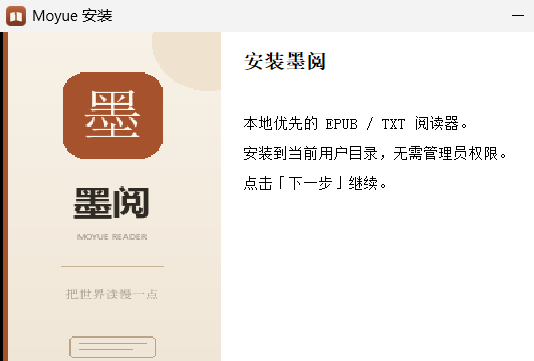
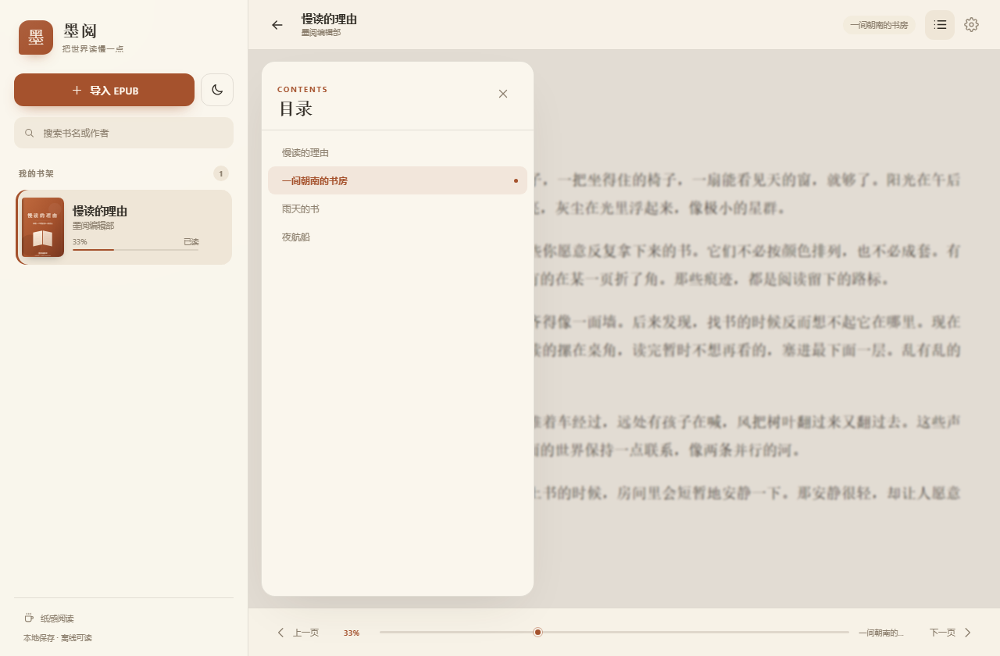
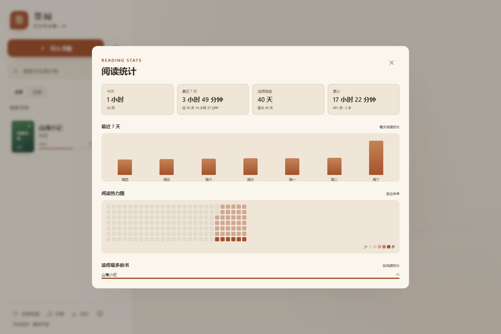

# 墨阅 · Moyue

一个安静、本地优先的桌面 EPUB / TXT 阅读器，带书架分类和本地音乐播放。

没有账号，没有云端同步。书籍、阅读进度、分类和音乐都留在这台电脑上。

## 下载

Windows 10/11 安装包：[GitHub Releases](https://github.com/Langlijun666/moyue-reader/releases)

安装包当前未做代码签名，Windows SmartScreen 可能提示「未知发布者」；选择「更多信息」→「仍要运行」即可。




## 功能

- **EPUB 2 / EPUB 3**：导入、解析元数据、封面、目录与正文
- **TXT 纯文本**：自动识别 UTF-8 / UTF-16 / GBK 编码，识别章节标题，并过滤作者更新说明
- **文件名识别**：从 `书名_作者.txt`、`书名 - 作者.txt`、`《书名》作者.txt` 等文件名自动提取书名和作者
- **本地书库**：使用 IndexedDB 保存书籍文件，重启后仍然可读；支持从资源管理器直接拖入 EPUB / TXT
- **自动更新**：启动静默检查、后台下载，下载完成后提示重启；支持跳过版本，更新包带签名校验
- **错误报告**：本地记录崩溃和异常，错误页面可重新加载、导出诊断；设置中可反馈问题或功能建议
- **书库备份**：手动备份 / 每天自动备份，保留最近 8 份；支持从 ZIP 恢复书籍、封面、进度、分类、书签、划线笔记、阅读统计、主题、字体和背景
- **自动续读**：记录阅读位置，重新打开回到上次那一页
- **全文搜索**：搜索整本书的内容，显示章节和上下文，点击结果跳到具体位置
- **书签**：给当前位置添加书签，在阅读助手中快速跳转或删除
- **划线与笔记**：选中正文划线，支持四种颜色、备注、笔记编辑和点击跳回原文
- **阅读统计**：记录每天阅读时长、页数、连续天数，提供最近 7 天和半年热力图
- **两种阅读模式**：左右翻页（按钮 / 滚轮 / 方向键）与上下滚动（一镜到底）
- **翻书动效**：纸页扫光、3D 翻页、横向滑动、淡入、轻微缩放、无动画六种可选，支持上一页反向动画
- **专注阅读**：一键隐藏左侧书架，让正文占满窗口
- **排版设置**：纸白 / 茶褐 / 夜墨三种主题，字号、字重、行距、宋体 / 黑体切换；支持导入本地字体、双栏、页边距和段间距
- **个性主题**：自定义背景色、文字色、强调色，内置六套配色，也可导入自己的图片作为阅读背景
- **书架分类**：自己创建分类，书籍可加入多个分类，支持「全部 / 分类 / 未分类」查看
- **两种书架布局**：左侧书架或全屏书架，阅读时自动让正文占满窗口
- **软件设置**：外观主题、书架视图、本机数据目录、版本与仓库信息
- **九套完整主题**：纸白、茶褐、夜墨、青瓷、樱粉、海盐、暮紫、松烟、深海，同步改变书库、侧栏、设置和阅读界面
- **自定义外观**：背景色、文字色、强调色可自由调整，也支持导入图片作为阅读背景
- **一键卸载**：应用内卸载，询问卸载原因，默认保留书库和阅读进度，也可选择彻底删除本地数据
- **品牌安装程序**：中文安装界面、墨阅头图与侧边图、应用图标
- **自定义封面**：为任意书籍选择本地图片，只修改书库显示，不改写原文件
- **本地音乐**：扫描本地音乐文件夹，支持 MP3 / FLAC / WAV / M4A / AAC / OGG / OPUS
- **音乐播放器**：顺序播放、列表循环、单曲循环、随机播放；上一首 / 下一首、进度、音量；关闭面板后继续播放
- **听书**：用系统中文语音朗读当前章节，从当前位置开始，当前句子在正文中高亮；支持暂停、语速、音色、定时关闭和自动下一章
- **离线自然语音**：可选下载 sherpa-onnx + MeloTTS 中文模型（下载约 190MB，安装后约 245MB），下载后不联网使用更自然的音色

| 阅读界面 | 目录 |
| --- | --- |
|  |  |

| 夜间模式 | 继续阅读 |
| --- | --- |
|  |  |

| TXT 阅读 | 自定义封面 |
| --- | --- |
|  |  |

| 上下滚动 | 专注阅读 |
| --- | --- |
|  |  |

| 书架分类 | 本地音乐 |
| --- | --- |
|  |  |

| 全屏书架 | 软件设置 |
| --- | --- |
|  |  |

| 听书 | 卸载 |
| --- | --- |
|  |  |

| 全文搜索 | 书签 |
| --- | --- |
|  |  |





## 技术栈

- **桌面外壳**：Tauri 2（Rust + 系统 WebView2）
- **前端**：React 19 + TypeScript + Vite 8
- **EPUB 渲染**：epub.js
- **TXT 转换**：JSZip 在内存中生成轻量 EPUB
- **本地存储**：IndexedDB（书籍、封面、TXT 原文）+ localStorage（进度、设置、分类、划线、统计）
- **音乐**：HTMLAudioElement + Tauri asset protocol
- **听书**：Web Speech API + Windows 系统中文语音（离线）
- **图标**：Python / Pillow 生成

## 开发环境

### Windows（主要支持平台）

- Node.js 20+
- Rust stable
- Visual Studio C++ Build Tools，勾选「使用 C++ 的桌面开发」
- WebView2 Runtime（Windows 10/11 通常已预装）

### macOS / Linux

需要安装 Tauri 对应的系统依赖，见 [Tauri prerequisites](https://v2.tauri.app/start/prerequisites/)。
当前音乐文件夹的「打开文件夹」按钮仅实现了 Windows 版本。

## 本地开发

```bash
npm install
npm run tauri:dev
```

只构建前端：

```bash
npm run build
```

构建桌面应用：

```bash
npm run tauri:build
```

生成安装包需要在系统中安装 Tauri 的打包依赖（Windows 通常是 NSIS / WiX）。

## 项目结构

```text
.
├─ src/                      # React 前端
│  ├─ components/            # 书架、阅读器、分类、音乐、设置
│  ├─ lib/                   # IndexedDB、EPUB/TXT 解析、分类、进度
│  ├─ App.tsx                # 应用状态与页面组合
│  └─ styles.css             # 主题与全部界面样式
├─ src-tauri/                # Tauri 2 / Rust
│  ├─ src/lib.rs             # 应用入口、音乐目录与文件扫描命令
│  ├─ capabilities/          # 窗口权限
│  ├─ icons/                 # 应用图标
│  ├─ installer/             # 安装程序头图、侧边图和中文文案
│  ├─ Cargo.toml
│  └─ tauri.conf.json
├─ public/
│  └─ sample.epub            # 内置示例书（原创内容）
├─ scripts/                  # 图标、示例书等开发脚本
├─ docs/                     # README 截图
├─ package.json
├─ package-lock.json
├─ LICENSE
└─ README.md
```

## 数据保存位置

应用不会把书籍和阅读数据上传到网络。

- WebView2 应用数据（书库、进度、分类、设置）：
  `%LOCALAPPDATA%\com.moyue.reader\EBWebView`
- 音乐文件夹：
  `%APPDATA%\com.moyue.reader\music`
- 书库备份：
  `%LOCALAPPDATA%\com.moyue.reader\backups`
- 应用安装目录：
  `%LOCALAPPDATA%\Moyue`

把歌曲文件放进音乐文件夹，打开音乐面板后点「刷新」即可。

## 书架视图

在「软件设置 → 书架视图」中切换：

- **左侧书架**：保持原来的左侧书架，阅读时书架和正文并排
- **全屏书架**：书架占满窗口；打开书籍后正文也占满窗口，返回书架时回到全屏视图

这个选择会自动保存，下次打开仍然生效。全屏书架模式下不再显示左下角书架控件，`Ctrl+B` 也不再生效；回到左侧书架模式后恢复。

## 听书

阅读界面右上角的耳机按钮打开听书面板：

- 使用 Windows 系统语音，不需要联网
- 可选择「离线自然语音」，首次需下载约 190MB（安装后约 245MB），之后完全离线
- 从当前位置开始朗读，当前句子在正文中高亮
- 读完当前章节自动进入下一章
- 暂停 / 继续、语速调节、中文音色选择
- 平静 / 叙事 / 悬疑 / 轻快四种朗读风格，按标点自动调整节奏和停顿
- 15 / 30 / 60 分钟定时关闭
- 关闭面板后继续朗读，左下角显示迷你播放条

当前版本支持句子高亮，但不会逐字高亮。音色取决于所选引擎：系统语音使用 Windows 已安装的语音；也可以在听书设置中下载离线自然语音。如果系统只有英文语音，可以在 Windows「设置 → 时间和语言 → 语音」中安装中文语音。

## 书库备份

在「软件设置 → 书库备份」中：

- **立即备份**：生成一个包含书籍文件、封面、进度、分类、书签、划线笔记、阅读统计、主题、字体和背景的 ZIP
- **自动备份**：每天首次打开时自动备份一次，保留最近 8 份
- **恢复备份**：选择 `.zip` 备份文件恢复
  - 恢复前会先自动备份当前书库
  - 采用合并方式，不会删除备份中没有的现有书籍
  - 同一本书会以备份中的版本为准

备份保存在：

```text
%LOCALAPPDATA%\com.moyue.reader\backups
```

备份不包含音乐文件夹中的歌曲。

## 阅读助手

阅读界面右上角的搜索按钮打开阅读助手，也可以按 `Ctrl+F`。

### 全文搜索

- 输入至少两个字，搜索整本书
- 首次搜索会建立索引，长书可能需要几秒
- 结果显示章节、上下文和匹配高亮
- 点击结果跳到具体匹配位置，而不是只跳到章节开头

### 书签

- 切换到「书签」标签
- 点击「添加当前位置书签」
- 点击书签跳转，点击垃圾桶删除
- 书签按书籍分别保存，重启后仍然保留

## 软件设置与卸载

点击书架底部的齿轮按钮打开「软件设置」：

- 切换纸白 / 茶褐 / 夜墨主题
- 查看本机数据目录，并直接打开文件夹
- 查看版本、GitHub 仓库和开源许可证
- 进入卸载流程

卸载时会先询问原因，并给出两个选项：

- **默认**：只卸载程序，保留书库、阅读进度、分类和设置
- **勾选删除本地数据**：同时清除书库、阅读进度、分类和设置，不可恢复
- 音乐文件夹里的歌曲始终不会被卸载程序删除

确认后会关闭墨阅并启动 NSIS 卸载程序。

## 快捷键

| 快捷键 | 功能 |
| --- | --- |
| `←` / `PageUp` | 上一页 |
| `→` / `PageDown` / `Space` | 下一页 |
| 鼠标滚轮向下 / 向上 | 左右翻页模式：下一页 / 上一页；滚动模式：向下 / 向上滚动 |
| `Ctrl+B` | 隐藏 / 显示左侧书架（仅左侧书架模式） |
| `Ctrl+F` | 打开全文搜索 |
| `Ctrl+O` | 导入 EPUB / TXT |
| `Esc` | 关闭目录 / 设置 / 分类弹窗 |

> 上下滚动模式下，滚轮和方向键直接滚动正文，不再触发翻页动画。

## 已知限制

- EPUB 和 TXT 是主要支持的格式，PDF、MOBI、AZW3 尚未支持
- TXT 章节识别依赖常见标题格式；没有标题时会按长度自动分节
- 音乐只读取本地文件夹，不读取音频内嵌标签；歌名 / 歌手按文件名解析
- 听书使用系统 TTS 或可选离线神经语音，音色取决于所选引擎
- 竖排暂未开放；双栏仅用于左右翻页模式
- 音乐「打开文件夹」目前只支持 Windows
- 安装包暂未使用 Windows 代码签名证书，首次安装可能触发 SmartScreen；自动更新使用独立的 minisign 签名校验
- 本地数据保存在 WebView2 中；清除应用数据会同时清除书库和进度

## 贡献

欢迎提交 issue 和 pull request。开发说明见 [CONTRIBUTING.md](CONTRIBUTING.md)。

反馈邮箱：`xuxinyang121@gmail.com`

## 支持墨阅

如果墨阅帮你省下了一点时间，可以请我喝杯咖啡。

赞助是一次性的，不会解锁任何功能，所有功能仍然免费。赞助主要用于代码签名证书、域名和后续开发。

| 支付宝 | 微信支付 |
| --- | --- |
|  |  |

付款前请确认收款方为「浪里君」。

赞助后如果想出现在公开感谢名单，可以提交[赞助登记](https://github.com/Langlijun666/moyue-reader/issues/new?template=sponsorship.yml)。名单只显示昵称，不显示金额或付款信息。

### 感谢支持者

- 浪里君

## 更新记录

见 [CHANGELOG.md](CHANGELOG.md)。

## License

[MIT](LICENSE)
